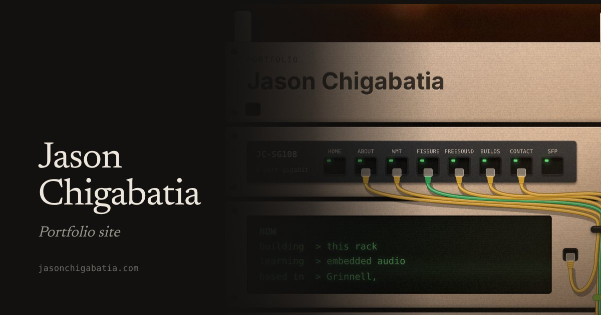

# kws-rack-portfolio

My portfolio site, built as a server rack you scroll through. Each shelf is a section, and each drive is a project.

**Live:** [jasonchigabatia.com](https://jasonchigabatia.com)



## Stack

React 19, TypeScript, Vite, GSAP + ScrollTrigger, Lenis, Floating UI, MDX. Hosted on Vercel.

## How it works

- On desktop, a scroll-driven camera moves down the rack and snaps to each shelf.
- On phones, the rack scrolls natively and snaps, since JS-driven cameras stutter on iOS.
- The switch ports work as nav, and a packet runs down the cable to the shelf you picked.
- Each project has a write-up in `web/src/content/projects/*.mdx`.

## Run it

```bash
cd web
npm install
npm run dev
```

## Credits

The rack is based on my real one, a 3D-printed [KWS Rack v2](https://makerworld.com/en/models/2139130) designed by Ilan Kushnir.
